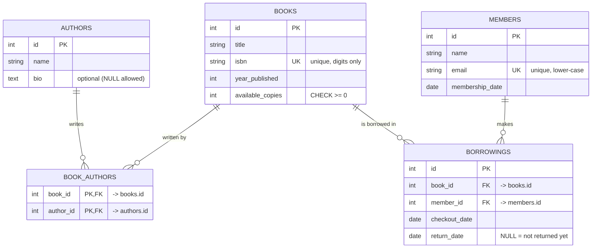

# 📚 Library Management System

A command-line application for managing a small library, built with **Python** and **SQLAlchemy 2.0** on a **SQLite** database.
You can add books, authors and members, check books out, return them, see each member's borrowings and find overdue books. The app enforces the library's rules, so it never lends a book with no copies left and never deletes a member who still has books out.

---

## Features

| Operation | What you can do |
|-----------|-----------------|
| **Create** | Add a book (with one or more authors), add a member, add an author, check out a book |
| **Read**   | List all books, search books by title, find books by author, view a member's current borrowings (and full history), list overdue books, list members and authors |
| **Update** | Return a book (sets `return_date`), update a member's email |
| **Delete** | Remove a book (only if not currently borrowed), remove a member (only if they have no active borrowings) |

Extras beyond the minimum: overdue detection (14-day loan period, showing days overdue), full borrowing history, input validation with re-prompting, sample data dated relative to today, and an automated test suite (36 tests).

---

## Entity-Relationship Diagram (ERD)



Plain-text version:

```
 AUTHORS 1 ──< BOOK_AUTHORS >── 1 BOOKS 1 ──< BORROWINGS >── 1 MEMBERS
 (id, name, bio)  (book_id,       (id, title, isbn,  (id, book_id, member_id,  (id, name, email,
                   author_id)      year_published,    checkout_date,             membership_date)
                                   available_copies)  return_date)
```

### Relationships

| Relationship | Type | How it is built |
|--------------|------|-----------------|
| books ↔ authors | **Many-to-many** | `book_authors` association table (composite primary key `book_id + author_id`). Navigate with `book.authors` and `author.books`. |
| books ↔ members | **Many-to-many with extra data** | `Borrowing` model with foreign keys to both tables plus `checkout_date` / `return_date`. |
| book → borrowings | **One-to-many** | `book.borrowings` ↔ `borrowing.book` |
| member → borrowings | **One-to-many** | `member.borrowings` ↔ `borrowing.member` |

All relationships are **bidirectional** (`back_populates` on both sides).

### Constraints enforced by the database

- `books.isbn` and `members.email` are `UNIQUE`.
- `books.available_copies >= 0` (`CHECK`).
- `borrowings.return_date` is NULL or not earlier than `checkout_date` (`CHECK`).
- Foreign keys are enforced (SQLite needs `PRAGMA foreign_keys=ON`, which `models.py` turns on for every connection).

---

## Project structure

```
library-management-system/
├── models.py          # SQLAlchemy 2.0 models (Mapped / mapped_column), engine, session factory
├── crud.py            # All Create / Read / Update / Delete functions + business rules
├── main.py            # CLI menu (loops until Exit, validates all input)
├── seed.py            # Loads sample_data.json into the database
├── sample_data.json   # 7 books, 4 authors, 5 members, 8 borrowings
├── requirements.txt   # Pinned dependencies
├── tests/
│   ├── conftest.py    # Test fixtures (uses a separate temporary database)
│   ├── test_crud.py   # Models, relationships, CRUD and edge cases
│   └── test_cli.py    # Drives the CLI menu end-to-end with scripted input
└── docs/
    ├── demo_run.txt       # Recorded run of the CLI
    └── test_results.txt   # Recorded pytest output
```

---

## Setup

Requires **Python 3.10+**.

```bash
# 1. Go into the project folder
cd library-management-system

# 2. Create and activate a virtual environment
python3 -m venv venv
source venv/bin/activate          # Windows: venv\Scripts\activate

# 3. Install the dependencies
pip install -r requirements.txt
```

## Usage

```bash
# (Optional) wipe the database and load the sample data
python seed.py

# Start the app
python main.py
```

The first time you start the app with an empty database it offers to load the sample data. The database is saved to `library.db` in the project folder. Set the `LIBRARY_DB_URL` environment variable to use a different database.

### Menu

```
📚 Library Management System
1. Add a book
2. Add a member
3. Search books            -> a) list all  b) by title  c) by author
4. Check out a book
5. Return a book
6. View member's borrowings
7. View overdue books
8. Exit
--- More options ---
9.  Add an author
10. Update a member's email
11. Remove a book
12. Remove a member
13. List all members
14. List all authors
15. Reset database with sample data
```

### Example session

```
Choose an option: 4
  [5] Emma Wilson <emma@example.com>  joined 2026-10-12, 0 active loan(s)
Member id: 5
  [8] Dune — Frank Herbert (1 available)
Book id: 8
Checkout date (YYYY-MM-DD, Enter for today):
✅ 'Dune' checked out to Emma Wilson (loan #9). Due back 2026-11-05. Copies left: 0.

Choose an option: 4
...
❌ 'Dune' has no available copies right now.
```

See [`docs/demo_run.txt`](docs/demo_run.txt) for a full recorded run.

### Sample data

Running `python seed.py` gives you:

- **7 books**, including *Good Omens*, which has **two authors** (shows the many-to-many link).
- **4 authors** and **5 members**.
- **8 borrowings**: 4 returned, 4 still out. Two of them are **overdue** (*A Wizard of Earthsea*, *The Left Hand of Darkness*).
- *Kindred* has **0 copies available**, so you can try the "can't borrow an unavailable book" rule.
- *Emma Wilson* has no active borrowings, so she can be removed. *Alice Johnson* cannot be removed.

Dates are stored as "days ago", so the data looks current whenever you seed it.

---

## Edge cases handled

| Situation | Result |
|-----------|--------|
| Check out a book with 0 copies | ❌ refused, copies stay at 0 |
| Member borrows the same book twice | ❌ refused |
| Return a book that was already returned | ❌ refused, copies are not increased twice |
| Return date before the checkout date or in the future | ❌ refused |
| Delete a book that is checked out | ❌ refused |
| Delete a member with active borrowings | ❌ refused |
| Duplicate ISBN / duplicate email / duplicate author | ❌ refused with a clear message |
| Invalid email, ISBN, year, or negative copies | ❌ refused |
| Letters where a number is expected, empty required field, wrong date format | CLI asks again |
| Unknown book / member / loan id | ❌ "No ... found with id ..." |
| Ctrl+C / Ctrl+D | exits cleanly |

**Session management:** every write in `crud.py` runs inside a `_transaction` helper that commits on success and **rolls back** on any error. A failed operation never leaves half-saved data, and the session can still be used afterwards. Each CLI action uses its own session (`with SessionLocal() as session:`).

---

## Testing

```bash
python -m pytest -v
```

The tests use a separate temporary database, so they never touch `library.db`.

- `tests/test_crud.py`: relationships in both directions, every CRUD function, every edge case above, and the database constraints (UNIQUE, CHECK, foreign keys).
- `tests/test_cli.py`: runs the menu end-to-end with scripted input, covering every menu option (including the add → checkout → view → return demo flow), invalid input and exit.

Result: **36 passed** (see [`docs/test_results.txt`](docs/test_results.txt)).

---

## Design decisions

1. **Borrowings are a full model, not a plain association table.** A borrowing has its own data (`checkout_date`, `return_date`) and its own identity, and the same member can borrow the same book many times. Giving it an `id` primary key and a model class keeps the full history and lets the app refer to a loan by its number.
2. **`available_copies` is updated in the same transaction as the borrowing.** Checking out lowers it by one and returning raises it by one, inside one commit, so the count and the borrowings can never get out of sync. A database `CHECK` constraint is a second safety net against negative stock.
3. **Rules live in `crud.py`, not in the CLI.** The CLI only collects input and prints results, so the same rules apply to the CLI, the seed script and the tests.
4. **Deleting a book or member also deletes its returned history** (`cascade="all, delete-orphan"`). Active borrowings block the delete, as the requirements say.
5. **ISBNs and emails are normalized** (hyphens removed, emails lower-cased) before saving, so `978-0-06-085398-3` and `9780060853983` count as the same ISBN.

## What I would add with more time

- A `genres` table (another many-to-many) and search across title, author and genre.
- Reports: most popular books, most active members.
- Export borrowing history to CSV with pandas.
- A `total_copies` column so the app can show "2 of 3 available".
